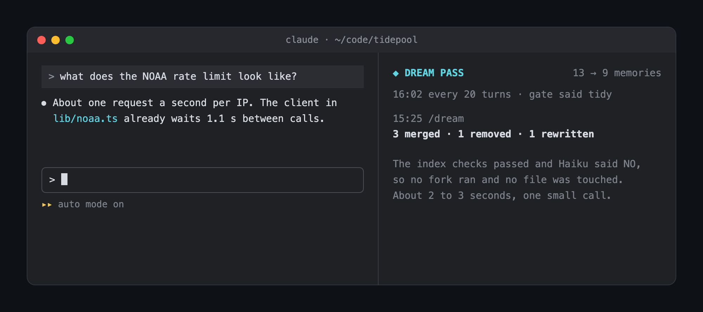

# dream-pass

A Claude Code mod that tidies Claude's memory folder the way sleep consolidates memories. Every so often it merges duplicate memories, rewrites the ones the conversation proved stale, removes dead ones and cleans up `MEMORY.md`. It backs up the folder first, and one command puts it back.


Auto memory only grows. Claude saves a fact, then a near copy of it a week later, then a note about a launch that has since happened, and the index passes 200 lines. Nobody goes back to clean it, so stale memories keep steering new sessions. This mod does the cleanup in the background, with the whole conversation as context, so it knows that "we moved to Fly.io" makes the Heroku note wrong.

- **Three triggers.** Every 20 turns, just before the conversation is compacted (so nothing said is lost), and `/dream`.
- **A cheap gate.** On the periodic trigger, code checks the index first for free: lines over 200 characters, pointers to missing files, files the index doesn't list. If those pass, Haiku reads the index, each file's description and what was said since the last check, and answers YES or NO. Most checks stop here.
- **A fork decides.** On YES, a fork of the session (full conversation, no tools) reads every memory file and replies with JSON: what to merge, rewrite, remove and add, and the new `MEMORY.md`.
- **It checks sources.** Claude Code stamps each memory with the session it came from (`originSessionId`). When two memories look like rivals, the mod pulls what you actually typed in those sessions, so the fork settles "staging.tidepool.app or tidepool-staging.fly.dev?" from evidence, not a guess.
- **It adds patterns.** The fork also sees what you said in your last five sessions, and saves a new memory only for something you said at least twice, like "run pnpm lint before you say it's done".
- **It keeps links straight.** Facts live in one file and are linked elsewhere with `[[name]]`. When two files merge, every `[[link]]` to the old one is pointed at the new one, in code.
- **The mod applies it, safely.** It copies the folder to `.dream-backup/<timestamp>/` first, with a `DREAM.md` that lists every edit and why. `/dream undo` restores it.

It never sends anything to Claude itself. The band, the pane and the toast are for you only.

Sources, patterns and `[[links]]` come from Cognition's [Agent Memory Repo](https://github.com/AgentMemoryRepo/agentmemoryrepo) spec and its description of Devin's Dreaming: *"Spot patterns across sessions and save them as new entries. Merge duplicates, remove outdated entries, and check sources to resolve contradictions."* This mod brings that to Claude Code's own memory folder.




## Install

```
claude plugin marketplace add ray-amjad/claude-code-mods
claude plugin install dream-pass@claude-code-mods
```

Or inside Claude Code: `/plugin marketplace add ray-amjad/claude-code-mods`, then `/plugin install dream-pass@claude-code-mods`.

Type `/dream where` to see which memory folder it will tidy before you let it dream.

## Usage

- `/dream` dreams now. The band above the prompt shows `Dream: dreaming over 13 memories`, then the counts.
- **Open** in the band (or `/dream show`) opens the pane: every dream this session, one row per file, with the reason.
- **Undo** in the band (or `/dream undo`) restores the folder from the last backup. A second undo goes one dream further back.
- **Hide** clears the band until the next dream.
- `/dream where` shows the memory folder it uses.

While a dream runs, Claude's own `Write` and `Edit` calls into the memory folder are refused with a "try again in a minute", so a memory saved mid-dream can't be overwritten.

### Try it on the example

The [`example`](example) folder belongs to a made-up founder, Sam, and their tide-chart app, Tidepool. Its `memory/` is messy on purpose: two files on pnpm, two on dashes, two staging URLs that disagree, a launch plan from March, a Heroku deploy note, an index line of 268 characters, a pointer to a file that doesn't exist and a file the index doesn't list. Beside it are five past session transcripts, laid out the way Claude Code keeps them: the sessions the memories came from, and two recent ones where Sam asks for `pnpm lint` twice.

```
cp -Rp example /tmp/dream-demo
DREAM_PASS_MEMORY_DIR=/tmp/dream-demo/memory claude
```

Tell Claude `we moved hosting from Heroku to Fly.io last week`, then type `/dream`. Open `/tmp/dream-demo/memory/MEMORY.md` before and after. Only the conversation knew about Fly.io, which is why the dream runs as a fork. Only the September transcript knew the old staging domain is gone, which is why the mod checks sources. And `pnpm lint` came up in two sessions, so it becomes a new memory.

Claude Code's own auto memory still saves to your real folder during the demo. Start with `CLAUDE_CODE_DISABLE_AUTO_MEMORY=1` if you don't want Tidepool facts in it.

## Settings

| Option | Default | What it does |
| :- | :- | :- |
| `everyTurns` | 20 | Turns between periodic checks. Set it with `/plugin configure dream-pass@claude-code-mods`. |
| `memoryDir` | empty | The folder to tidy. Empty means Claude Code's own: `autoMemoryDirectory` from your settings if set, else `~/.claude/projects/<project>/memory` (the git root's, and `CLAUDE_CONFIG_DIR` is respected) |
| `DREAM_PASS_EVERY` (env) | unset | Overrides `everyTurns` for one session, handy for a demo: `DREAM_PASS_EVERY=3 claude` |
| `DREAM_PASS_MEMORY_DIR` (env) | unset | Points it at another folder for one session |
| `DREAM_PASS_TRANSCRIPTS_DIR` (env) | unset | Where the session transcripts are. By default, the folder that holds the memory folder, which is where Claude Code keeps them |

## How it works

- `turn.complete` counts the main conversation's turns in `$.store`. Every N turns the gate runs in the background, so the next prompt never waits for it.
- The gate's free checks are plain code over `MEMORY.md`. If they find a problem it dreams straight away, with no Haiku call. Otherwise one `$.model.complete` call to Haiku sees the index, each file's frontmatter description and the conversation since the last check, and only an exact `YES` dreams.
- Before the dream, the mod gathers evidence the fork can't fetch itself, since a fork has no tools. Memories that share a keyword are suspects; for up to 10 of their `originSessionId`s it reads the transcript and keeps the three lines you typed that mention the memory's words. It also keeps the last 1,500 characters you typed in each of the 5 most recent sessions.
- The dream reads every `*.md` file with `$.fs`, then calls `$.model.fork`. A fork replays the session's own transcript (mostly from the prompt cache) with the files attached. It can't call tools, so its only output is the JSON. With nothing to fork yet, as in a fresh session, it falls back to Sonnet with the files alone.
- The mod applies the JSON itself: `$.fs.write` for new content and `rm -f` for removals (on Windows, which has no `rm`, a PowerShell `Remove-Item` that gets each path in an environment variable, never in the script), only for bare `*.md` names inside the folder, never deleting `MEMORY.md`. Index lines that point at missing files are dropped in code, whatever the model wrote.
- `session.compact` starts the dream and returns at once, so compaction is never held up. The dream starts before the transcript is summarized.
- Claude Code's own auto-dream writes its PID to `.consolidate-lock` in the memory folder while it runs. If that lock is under an hour old and the process is alive, dream-pass skips, so the two never rewrite the folder at once.

Because the files are written by the mod's own code, **the writes skip every permission prompt, in every mode.** The file-name check and the backup are the only guards. Read `hooks/register.js` before you install it.

## How it differs from Claude Code's auto-dream

Claude Code has its own consolidation pass, auto-dream, switched on with the `autoDreamEnabled` setting or the Auto-dream toggle in `/memory`. This is how the two compare in Claude Code 2.1.296, read from the shipped code.

| | Claude Code auto-dream | dream-pass |
| :- | :- | :- |
| **When it runs** | At most once a day: 24 hours and 5 sessions since the last one (both tunable from the server) | Every 20 turns behind a gate, just before compaction, and on `/dream` |
| **Run it by hand** | No | `/dream` |
| **What it learns from** | Greps past session transcripts itself and checks the codebase | The live conversation (a full fork), plus source excerpts and your last 5 sessions, gathered by the mod |
| **Contradictions** | Against the codebase and CLAUDE.md | Against the conversation, the sessions each memory came from, and CLAUDE.md |
| **New memories** | Writes whatever it finds worth keeping | Only something you said at least twice |
| **Who edits the files** | A forked agent with tools: read-only shell, plus Write, Edit and `rm` inside the memory folder | A fork with no tools replies with JSON; the mod applies it, bare `*.md` names only |
| **Links** | Not handled | `[[links]]` to merged files are redirected in code |
| **Backup and undo** | None | A full backup per dream, a `DREAM.md` of every edit, and `/dream undo` |
| **What you see** | A background task and "Improved N memory files" | A band with Open, Undo and Hide, and a pane listing each change and why |

They do different jobs: auto-dream is a slow pass across many sessions, dream-pass catches what this session knows before compaction loses it. They can run side by side. While auto-dream holds its `.consolidate-lock`, dream-pass skips.

## Limits

- A dream takes 15 to 30 seconds and costs one fork of the session. The gate keeps that to the turns that need it.
- In a terminal under 144 columns the pane opens inline above the prompt and takes the band's place. Wider, or with fullscreen rendering, it docks beside the transcript.
- A file whose subject changes keeps its old name (`project_deploy_heroku.md` ends up describing Fly.io). Renames aren't supported.
- The fork is judging, so expect the odd merge you disagree with. The backup and `/dream undo` are there for that.
- On compaction the dream isn't awaited. In testing the fork still saw the full conversation, but that is timing, not a guarantee.
- The pane's history lives in memory and resets when the mod reloads. The backups stay on disk.
- Source checking only works for memories with an `originSessionId` whose transcript still exists. Claude Code adds that id to the memories it saves; older or hand-written ones have none, and the fork judges those from the text alone.
- A fork needs a response from this session to fork. Typed as the very first prompt, `/dream` falls back to Sonnet with the files and the evidence, but not the conversation.

## Develop

```
claude --plugin-dir ./dream-pass
claude plugin validate .
claude plugin test .
```

For headless runs, `DREAM_PASS_SYNC=1` waits for the gate and the dream before the turn ends.

Tested with Claude Code 2.1.296.
